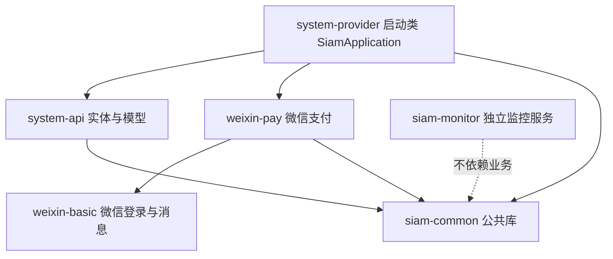
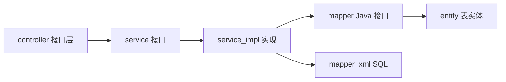

# siam-server 后端目录结构说明

> 一句话总览：这是**后端仓库**，但为了部署方便，4 个前端工程、SQL 脚本、发版脚本也放在这里，所以顶层看起来乱。
> 真正的后端只有 4 个 Maven 模块：`siam-common`、`siam-weixin`、`siam-system`、`siam-monitor`。

## 导航

1. [顶层目录：谁是谁](#一顶层目录谁是谁)
2. [后端模块依赖关系](#二后端模块依赖关系)
3. [后端核心 siam-system](#三后端核心siam-system)
4. [业务域划分 modular](#四业务域划分modular)
5. [我要改 X，去哪找](#五我要改-x去哪找)
6. [配置、启动与部署](#六配置启动与部署)

## 一、顶层目录：谁是谁

| 目录 | 类型 | 说明 |
| --- | --- | --- |
| `siam-common` | 后端模块 | 公共基础库：统一返回、业务异常、工具类、登录上下文、WebSocket、RabbitMQ 配置 |
| `siam-weixin` | 后端模块 | 微信能力封装：`weixin-basic` 微信登录/模板消息，`weixin-pay` 微信支付 |
| `siam-system` | 后端模块 ★ | 全部业务代码，含 `system-api` + `system-provider` 两个子模块，**日常开发主战场** |
| `siam-monitor` | 后端模块 | 独立监控服务（SpringBoot Admin 单体），与业务无关 |
| `siam-generator` | 工具 | 第三方代码生成器 kitty，独立运行，不在主 pom 的 modules 中 |
| `vue-siam-admin` | 前端 | 平台管理端 |
| `vue-siam-shop` | 前端 | 商家端 PC |
| `uniapp-siam-user` | 前端 | 会员端小程序（uni-app） |
| `uniapp-siam-cashier` | 前端 | 收银端（uni-app） |
| `cashier-web` | 前端 | 收银台 Web 静态包（`dist/` 会提交，供云托管部署） |
| `sql` | 数据 | `mysql/siam_db.sql` 基线 + 编号增量脚本 + `cloudrun/` 线上粘贴版 + `archive/` 历史备份 |
| `deploy` | 运维 | 微信云托管发版脚本与压缩包 |
| `bin` | 运维 | 中间件与启动脚本（`middleware/`、`docker/`、`jar/`） |
| `doc` | 文档 | 图片资源与本说明 |
| `logs`、`upload` | 运行时 | 日志、本地 OSS 上传目录，均不入库 |

## 二、后端模块依赖关系

打包时 `mvn -pl siam-system/system-provider -am` 即可，其余模块是它的依赖。

## 三、后端核心 siam-system

拆成两个子模块，职责不同：

- **system-api**：只有数据模型，无业务逻辑，供其他模块引用
  - `entity/` 数据库表实体（按业务域分包，`internal/` 为附加业务实体）
  - `model/` 传输对象：`param` 入参、`vo`/`result` 出参、`dto` 中间对象、`example` MyBatis 查询条件
  - `package_user/jwt`、`auth/` 登录鉴权模型
- **system-provider**：真正打 jar 运行的服务
  - `SiamApplication.java` 启动类
  - `config/` Spring 配置（MyBatisPlus、Swagger、RocketMQ、WebMvc、定时任务）
  - `interceptor/` 三端登录拦截器：Admin / Merchant / Member
  - `modular/` 全部业务代码（见第四节）

### 业务分层调用链

## 四、业务域划分 modular

`modular/` 下按业务域分包，每个域内部又是 controller / service / service_impl / mapper / mapper_xml 的同一套分层。

| 包名 | 业务域 | 典型内容 |
| --- | --- | --- |
| `package_goods` | 商品与营销 | 菜品、规格、菜单、优惠券、满减、购物车、集赞评价；`mqConsumer/`、`mq_listener/` 消息处理 |
| `package_order` | 订单 | 下单、订单详情、退款退货、改单、自配送；`executor/` 定时任务、`mq_consumer/` 消息消费 |
| `package_user` | 账号与资金 | 管理员/商家/会员账号、登录 Token、余额、提现、账单流水、实名认证 |
| `package_dining` | 堂食桌台 | 桌位/桌型/区域、扫码点单、堂食会话、扫码结账 |
| `package_service` | 增值服务 | 存酒/取酒、发票申请与审批、公告 |
| `package_points` | 会员积分 | 积分规则、等级设置、积分流水 |
| `package_log` | 日志 | 操作日志（注解 + AOP 切面）、登录日志 |

### 三个关键词

- **controller 下按端再分组**：`admin` 管理端、`merchant` 商家端/收银、`member` 会员端小程序。
- **`internal` 子包**：与主流程并列的附加业务（积分商城、骑手、VIP 充值、打印机、店铺设置等），不是"内部调用"的意思。
- **SQL 不在 Java 目录里**：`mapper/*.java` 是接口，`mapper_xml/*.xml` 才是 SQL，两者分开两个目录。

## 五、我要改 X，去哪找

| 需求 | 位置 |
| --- | --- |
| 小程序会员端接口 | `modular/package_*/controller/member/` |
| 管理端接口 | `modular/package_*/controller/admin/` |
| 商家端/收银接口 | `modular/package_*/controller/merchant/` |
| 订单业务逻辑 | `modular/package_order/service_impl/` |
| SQL 语句 | `modular/package_*/mapper_xml/` |
| 表实体、出入参模型 | `system-api` 对应包的 `entity/`、`model/` |
| 微信支付对接 | `siam-weixin/weixin-pay` |
| 微信登录、模板消息 | `siam-weixin/weixin-basic` |
| 统一返回、异常、工具类 | `siam-common/package_common/` |
| 建表/改表脚本 | `sql/mysql/cloudrun/`（编号增量），历史备份放 `sql/mysql/archive/` |

## 六、配置、启动与部署

- 启动类：[SiamApplication.java](file:///Volumes/app/project/wechat/siam-server/siam-system/system-provider/src/main/java/com/siam/system/SiamApplication.java)
- 配置：`system-provider/src/main/resources/application.yml` 通过 Maven profile `@spring.active@` 切换 `application-local.yml`（本地）、`application-mvp.yml`（云托管 MVP）等
- 本地默认端口 9200，context-path `/siam-server`
- 云托管发版：根目录 `Dockerfile` + `deploy/deploy-wxcloud.sh`（只构建后端模块）

## 附注

项目根目录 `/Volumes/app/project/wechat` 下还有其他工程，不属于本后端仓库：

- `orderFood-wxCloud`：微信云开发版小程序（含 `cloudfunctions` 云函数）
- `order-project`、`order-project-整理`：旧版小程序
- `xpyun-opensdk-java-demo`：芯烨云打印 SDK 示例